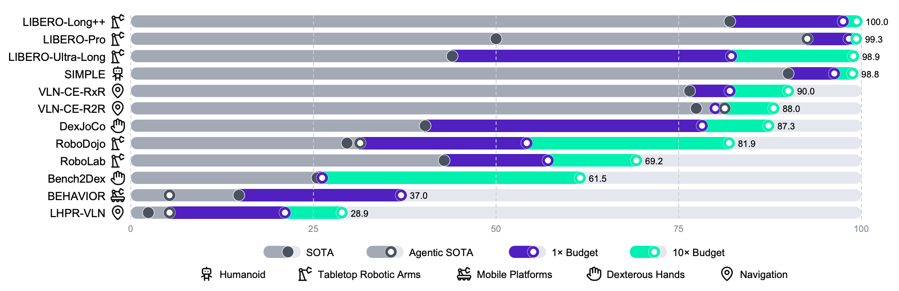
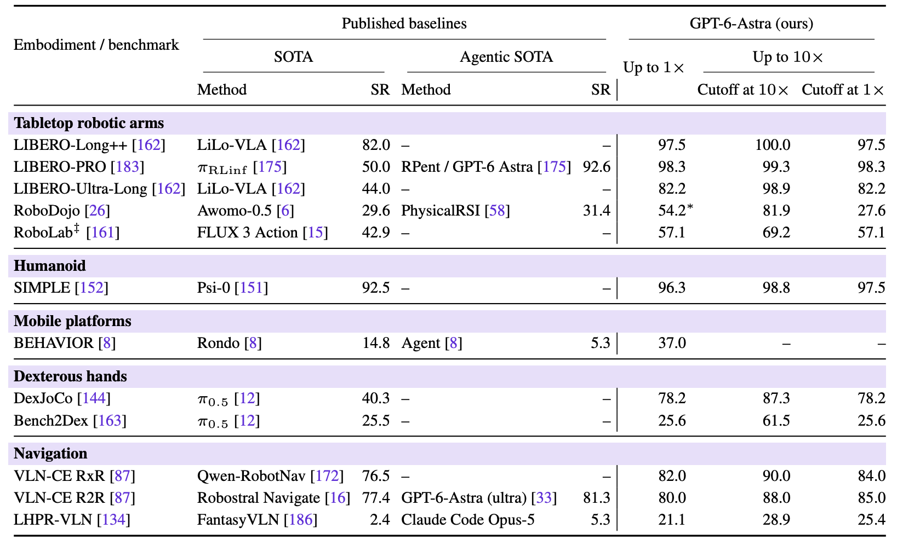

<div align="center" style="font-family: charter;">

 <h1>Towards Long-Horizon Vision-Language Navigation:</br> Platform, Benchmark and Method (CVPR-25)</h1>
 

<br />

<a href="https://arxiv.org/abs/2412.09082" target="_blank">
    
</a>
<a href="https://hcplab-sysu.github.io/LH-VLN/" target="_blank">
    
</a>
<a href="https://github.com/HCPLab-SYSU/LH-VLN" target="_blank" style="display: inline-block; margin-right: 10px;">
    
</a>

<div>
    <a href="songxsh@mail2.sysu.edu.cn" target="_blank">Xinshuai Song</a><sup>1*</sup>,</span>
    <a href="chenwx228@mail2.sysu.edu.cn" target="_blank">Weixing Chen</a><sup>1*</sup>, </span>
    <a href="liuy856@mail.sysu.edu.cn" target="_blank">Yang Liu</a><sup>1,3</sup>,</span>
    <a href="chenwk891@gmail.com" target="_blank">Weikai Chen</a><sup> </sup>,</span>
    <a href="liguanbin@mail.sysu.edu.cn" target="_blank">Guanbin Li</a><sup>1,2,3</sup>,</span>
    <a href="linliang@ieee.org" target="_blank">Liang Lin</a><sup>1,2,3</sup>,</span>
</div>

<div>
    <sup>1</sup>Sun Yat-sen University&emsp;
    <sup>2</sup>Peng Cheng Laboratory&emsp;
    <sup>3</sup>Guangdong Key Laboratory of Big Data Analysis and Processing&emsp;
</div>
<br />
<p align="justify"><i>Existing Vision-Language Navigation (VLN) methods primarily focus on single-stage navigation, limiting their effectiveness in multi-stage and long-horizon tasks within complex and dynamic environments. To address these limitations, we propose a novel VLN task, named Long-Horizon Vision-Language Navigation (LH-VLN), which emphasizes long-term planning and decision consistency across consecutive subtasks. Furthermore, to support LH-VLN, we develop an automated data generation platform NavGen, which constructs datasets with complex task structures and improves data utility through a bidirectional, multi-granularity generation approach. To accurately evaluate complex tasks, we construct the Long-Horizon Planning and Reasoning in VLN (LHPR-VLN) benchmark consisting of 3,260 tasks with an average of 150 task steps, serving
as the first dataset specifically designed for the long-horizon vision-language navigation task. Furthermore, we propose Independent Success Rate (ISR), Conditional Success Rate (CSR), and CSR weight by Ground Truth (CGT) metrics, to provide fine-grained assessments of task completion. To improve model adaptability in complex tasks, we propose a novel Multi-Granularity Dynamic Memory (MGDM) module that integrates short-term memory blurring with long-term memory retrieval to enable flexible navigation in dynamic environments. Our platform, benchmark and method supply LH-VLN with a robust data generation pipeline, comprehensive model evaluation dataset, reasonable metrics, and a novel VLN model, establishing a foundational framework for advancing LH-VLN. </i></p>
</div>

## LHPR-VLN in the GPT-6-Astra Embodied Intelligence Study

**Long-horizon navigation remains an open challenge for frontier embodied agents.** The technical report [*Has GPT-6-Astra Achieved Embodied Intelligence?*](https://www.sensenova.ai/has-gpt-6-astra-achieved-embodied-intelligence) includes **our LHPR-VLN benchmark** in its evaluation across 12 embodied AI benchmarks. With training-set in-context learning (ICL) and an interaction budget of up to **10×**, GPT-6-Astra achieves **28.9% full-sequence success** on LHPR-VLN, the lowest extended-budget success rate reported in the study. This highlights the continuing value of LHPR-VLN for studying long-term planning, progress tracking, and consistent execution across successive navigation goals.

### Figure 1: Performance across 12 embodied AI benchmarks

<p align="center">
  <a href="static/images/gpt6-astra-embodied-figure1.png">
    
  </a>
</p>

*Source: Figure 1, Joint Research Team, [Has GPT-6-Astra Achieved Embodied Intelligence?](https://www.sensenova.ai/gpt-6/assets/docs/has_gpt-6_achieved_embodied_intelligence.pdf#page=1). The study permits training-set ICL and up to 10× the action-step budget. RoboLab uses no ICL; BEHAVIOR is evaluated only at 1×. Published-baseline cutoff: October 12, 2026.*

### Table 2: Benchmark-level success rates

<p align="center">
  <a href="static/images/gpt6-astra-embodied-table2.png">
    
  </a>
</p>

*Source: Table 2 of the [technical report](https://www.sensenova.ai/gpt-6/assets/docs/has_gpt-6_achieved_embodied_intelligence.pdf#page=38), reproduced with its original headers and values. “Ours” in the table refers to the report authors' GPT-6-Astra setup.*

Explore the [LHPR-VLN dataset](#lhpr-vln-dataset), [NavGen pipeline](#navgen-pipeline), and [benchmark](#benchmark) to build and evaluate agents for long-horizon navigation.

## MMSP2025-Challenge

The 1st Long-Horizon Vision-Language Navigation Challenge based on the “Embodied AI Challenge” track of the IEEE 27th International Workshop on Multimedia Signal Processing (MMSP 2025) is opened! Please go to the challenge [page](https://hcplab-sysu.github.io/LH-VLN/contest/) for more information. 

## Preparation

### Environment

This project is developed with Python 3.9. You can use [miniconda](https://docs.conda.io/en/latest/miniconda.html) or [anaconda](https://anaconda.org/) to create the environment:

```bash
conda create -n lhvln python=3.9
conda activate lhvln
```

We use [Habitat-Sim](https://github.com/facebookresearch/habitat-sim/tree/main) as simulator, which can be [built from source](https://github.com/facebookresearch/habitat-sim/blob/main/BUILD_FROM_SOURCE.md#build-from-source) or installed from conda:

```bash
conda install habitat-sim==0.3.1 headless -c conda-forge -c aihabitat
```

Then you can install the environment required for the project:

```bash
git clone https://github.com/HCPLab-SYSU/LH-VLN.git
cd LH-VLN
pip install -r requirements.txt
```

### Data

We use [HM3D](https://aihabitat.org/datasets/hm3d/) as the scene dataset. You can download the splits we need by following the command below. Note that you need to submit an application to [Matterport](https://matterport.com/legal/matterport-end-user-license-agreement-academic-use-model-data) before using it. For more information, please refer to [this link](https://github.com/facebookresearch/habitat-sim/blob/main/DATASETS.md#habitat-matterport-3d-research-dataset-hm3d).

```bash
python -m habitat_sim.utils.datasets_download --username <api-token-id> --password <api-token-secret> --uids hm3d_train_v0.2
python -m habitat_sim.utils.datasets_download --username <api-token-id> --password <api-token-secret> --uids hm3d_val_v0.2
```

In NavGen, we use the pre-trained model of [RAM](https://github.com/xinyu1205/recognize-anything). You can download the model [here](https://huggingface.co/xinyu1205/recognize-anything-plus-model/blob/main/ram_plus_swin_large_14m.pth).

We used pre-trained `clip` and `bert` in the model encoding, and their weights can be obtained from the following links: [EVA02_CLIP_L_336_psz14_s6B.pt](https://huggingface.co/QuanSun/EVA-CLIP/blob/main/EVA02_CLIP_L_336_psz14_s6B.pt), [clip-vit-base-patch16](https://huggingface.co/openai/clip-vit-base-patch16) and [bert-large-uncased](https://huggingface.co/google-bert/bert-large-uncased).

Your final directory structure should be like this:

```
LH-VLN
├── data
│   ├── hm3d
│   │   ├── train
│   │   ├── val
│   │   ├── hm3d_annotated_basis.scene_dataset_config.json
│   └── models
│   │   ├── ram_plus_swin_large_14m.pth
│   │   ├── EVA02_CLIP_L_336_psz14_s6B.pt
│   │   ├── clip-vit-base-patch16
│   │   ├── bert-large-uncased
│   ├── task
│   │   ├── batch_1
│   │   ├── ...
│   │   ├── batch_8
│   ├── step_task
│   │   ├── batch_1
│   │   ├── ...
│   │   ├── batch_8
│   ├── episode_task
│   │   ├── batch_1.json.gz
│   │   ├── ...
│   │   ├── batch_8.json.gz
```

## LHPR-VLN Dataset

Our dataset is now available in [Hugging Face](https://huggingface.co/datasets/Starry123/LHPR-VLN) and [ModelScope](https://modelscope.cn/datasets/starry123/LHPR-VLN). Thanks a lot for your patience!

## NavGen Pipeline

After completing the preparations, you can now refer to the [guide](https://github.com/HCPLab-SYSU/LH-VLN/tree/master/nav_gen#readme) to generate your LH-VLN task!

## Benchmark

You can adjust the parameters in `configs/lh_vln.yaml` based on your own needs.

Run:
```bash
python train.py
```
Or use distributed：
```bash
torchrun --nnodes=1 --nproc_per_node=4 train.py  
```
Please set based on your machine configuration.

## Baseline

We currently provide a simplified version of the model and expand its adaptability so that it can be trained and inferenced on Llama/Qwen-based models of different scales (from 0.5B to 13B and more). You can adjust the parameters in `configs/model.yaml` based on your own needs.（Change the config file in `utils/parser.py`.)

Run:
```bash
python train.py
```
Or use distributed：
```bash
torchrun --nnodes=1 --nproc_per_node=4 train.py  
```
Please set based on your machine configuration.

In addition, we also provide the supervised fine-tuning code using VLA data, please refer to `sft.py`.

In the paper, we used 4 A800s to train at bf6 accuracy for 48 hours, each using 80GB of VRAM. But now we provide a simplified version of the model and expand its adaptability so that it can be trained and inferenced on Llama/Qwen-based models of different scales (from 0.5B to 13B and more). This means you can use a single 3090 to train a smaller model.

## Acknowledgement

We used [RAM](https://github.com/xinyu1205/recognize-anything)'s source code in `nav_gen/recognize_anything` and [EVA](https://github.com/baaivision/EVA/tree/master)'s source code in `NavModel/LLMModel/EVA`. Besides, we refer to some codes of [NaviLLM](https://github.com/zd11024/NaviLLM). Thanks for their contribution!!

## Citation

If you find our paper and code useful in your research, please consider giving us a star :star: and citing our work :pencil: :)
```
@inproceedings{song2024towards,
  title={Towards long-horizon vision-language navigation: Platform, benchmark and method},
  author={Song, Xinshuai and Chen, Weixing and Liu, Yang and Chen, Weikai and Li, Guanbin and Lin, Liang},
  booktitle={Proceedings of the IEEE/CVF Conference on Computer Vision and Pattern Recognition},
  year={2025}
}
```
